  

## Download

- **macOS** · Apple silicon · `v0.3.16` — [Download](https://github.com/nextstream-admin/nextstream-release/releases/download/installers-2026-11-06/NextStream-macOS-arm64-v0.3.16.dmg)
- **Windows** · x64 · `v0.3.16` — [Download](https://github.com/nextstream-admin/nextstream-release/releases/download/installers-2026-11-06/NextStream-Windows-x64-v0.3.16.exe)
- **Samsung** · Tizen · `v0.0.8` — [Download](https://github.com/nextstream-admin/nextstream-release/releases/download/installers-2026-11-06/NextStream-Samsung-Tizen-v0.0.8.wgt)
- **LG** · webOS · `v0.0.10` — [Download](https://github.com/nextstream-admin/nextstream-release/releases/download/installers-2026-11-06/NextStream-LG-webOS-v0.0.10.ipk)
- **Android TV** · `v0.3.20` — [Download](https://github.com/nextstream-admin/nextstream-release/releases/download/installers-2026-11-06/NextStream-Android-v0.3.20.apk)
- **Browser** · no install — [Open in your browser](https://comingupnext.web.app)

The TV packages are shell loaders; their versions move separately from the app. macOS is unnotarized, Windows is unsigned, Android is debug-signed.

Install notes

- **macOS** — Apple silicon only. Open the DMG and drag **NextStream** into Applications. If macOS blocks it: **System Settings → Privacy & Security → Open Anyway**.
- **Windows** — Run the installer. SmartScreen may warn because it is unsigned; choose **More info → Run anyway** only if you trust the source.
- **Samsung / LG** — Sideload the `.wgt` / `.ipk` through developer mode. The package version is the shell; the app version is shown inside NextStream.
- **Android TV** — Sideload the `.apk`; enable **Install unknown apps** for your file manager or ADB first.

---

## About

NextStream is a debrid-only streaming client for the big screen. It keeps the catalogue, Continue Watching, search and subtitles in one place, then hands playback to the platform's native player.

Create a NextStream account and connect a supported debrid service. NextStream does not host or provide media.

---

`SHA256SUMS.txt` ships with every release — verify with `shasum -a 256 -c SHA256SUMS.txt` on macOS, or `sha256sum -c SHA256SUMS.txt` on Windows/Linux.

[Home](https://comingupnext.web.app) · [Latest release](https://github.com/nextstream-admin/nextstream-release/releases/latest) · [All builds](https://github.com/nextstream-admin/nextstream-release/releases) · [Issues](https://github.com/nextstream-admin/nextstream-release/issues)

 NextStream

