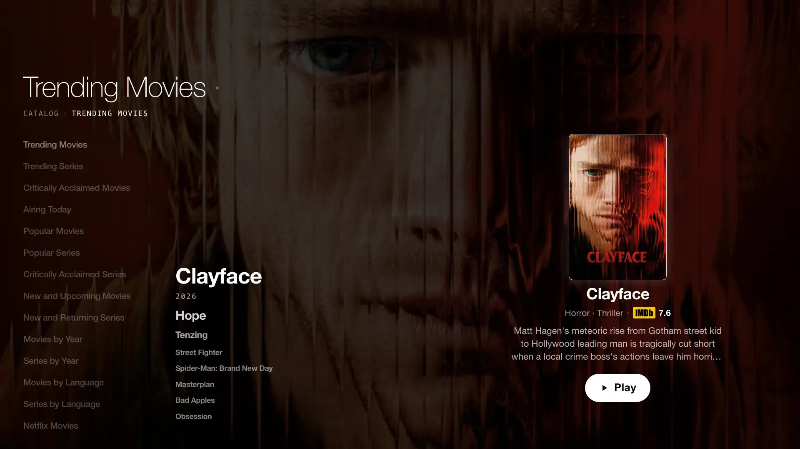

<p align="center">
  
</p>

<p align="center">
  <a href="https://github.com/nextstream-admin/nextstream-release/releases/latest"></a>
  <a href="https://comingupnext.web.app"></a>
  
</p>

<p align="center">
  <strong>Your library. Your screens. Press play.</strong><br>
  <sub>NextStream is a debrid-only streaming client built for the big screen.</sub>
</p>

---

## Download

| Platform | Package | Version | Size |  |
| :--- | :--- | :---: | ---: | :--- |
| **macOS** · Apple Silicon | `NextStream-macOS-arm64-v0.3.16.dmg` | `0.3.16` | 31.4 MB | [**Download**](https://github.com/nextstream-admin/nextstream-release/releases/download/installers-2026-11-06/NextStream-macOS-arm64-v0.3.16.dmg) |
| **Windows** · x64 | `NextStream-Windows-x64-v0.3.16.exe` | `0.3.16` | 41.9 MB | [**Download**](https://github.com/nextstream-admin/nextstream-release/releases/download/installers-2026-11-06/NextStream-Windows-x64-v0.3.16.exe) |
| **Samsung TV** · Tizen | `NextStream-Samsung-Tizen-v0.0.8.wgt` | `0.0.8` | 46.8 KB | [**Download**](https://github.com/nextstream-admin/nextstream-release/releases/download/installers-2026-11-06/NextStream-Samsung-Tizen-v0.0.8.wgt) |
| **LG TV** · webOS | `NextStream-LG-webOS-v0.0.10.ipk` | `0.0.10` | 44.4 KB | [**Download**](https://github.com/nextstream-admin/nextstream-release/releases/download/installers-2026-11-06/NextStream-LG-webOS-v0.0.10.ipk) |
| **Android TV** | `NextStream-Android-v0.3.20.apk` | `0.3.20` | 32.8 MB | [**Download**](https://github.com/nextstream-admin/nextstream-release/releases/download/installers-2026-11-06/NextStream-Android-v0.3.20.apk) |

> [!NOTE]
> The TV packages are **shell loaders**, not copies of the web app. Their versions move
> separately from the desktop and Android builds. The app itself updates from the
> service when the TV launches.

---

## A quieter way to watch

NextStream keeps the catalogue, Continue Watching, search, profiles and subtitles in
one interface, then hands playback to the platform's native player. No second app, no
browser tab in the middle.

<p align="center">
  
</p>
<p align="center"><sub>The Lite catalogue, running on a TV.</sub></p>

| | |
| :--- | :--- |
| **Native playback** | libmpv on desktop, AVPlay on Tizen, the native webOS pipeline, ExoPlayer/Media3 on Android. |
| **Subtitles that belong** | Styled ASS/SSA through libass, PGS/VobSub bitmap tracks, and plain text — chosen per title. |
| **One library** | WatchSync carries your profiles, Continue Watching and My List across every screen. |
| **Built to be quiet** | Calm type, one clear action, no clutter. |

---

## Before you install

> [!WARNING]
> These builds are **unsigned, unnotarized or debug-signed**. macOS is unnotarized,
> Windows is unsigned, and the Android APK is debug-signed. Your OS may warn you.
> Only run packages downloaded from this repository.

| Platform | Install notes |
| :--- | :--- |
| **macOS** | Apple Silicon (arm64) only. Open the DMG and drag **NextStream** into Applications. If macOS blocks it: **System Settings → Privacy & Security → Open Anyway**. No Intel or universal build is published here. |
| **Windows** | Windows x64. Run the installer and launch **NextStream** from the Start menu. SmartScreen may warn because the installer is unsigned; choose **More info → Run anyway** only if you trust the source. |
| **Samsung Tizen** | `.wgt` package for a Tizen TV. Install through Tizen developer mode with the Samsung/Tizen tooling. The package version is the **shell** version; the app version is shown inside NextStream. |
| **LG webOS** | `.ipk` package for a webOS TV. Install through LG Developer Mode with the webOS CLI. The package version is the **shell** version; the app version is shown inside NextStream. |
| **Android TV** | Sideload the `.apk` on Android TV, Google TV or Fire TV. Enable **Install unknown apps** for your file manager / ADB first. This is a debug-signed build, not a Play Store release. |
| **Browser** | No installer. Open **[comingupnext.web.app](https://comingupnext.web.app)** and choose **Watch in your browser**. WatchSync sign-in is required; there is no anonymous route. |

---

## Verify your download

Every release ships a `SHA256SUMS.txt` next to the installers.

```sh
# macOS
shasum -a 256 -c SHA256SUMS.txt

# Windows / Linux
sha256sum -c SHA256SUMS.txt
```

[**Download checksums**](https://github.com/nextstream-admin/nextstream-release/releases/download/installers-2026-11-06/SHA256SUMS.txt) ·
[**All releases**](https://github.com/nextstream-admin/nextstream-release/releases)

---

## Links

| | |
| :--- | :--- |
| Home | [comingupnext.web.app](https://comingupnext.web.app) |
| Latest release | [github.com/nextstream-admin/nextstream-release/releases/latest](https://github.com/nextstream-admin/nextstream-release/releases/latest) |
| Issues / feedback | [Open an issue](https://github.com/nextstream-admin/nextstream-release/issues) |
| Previous builds | [All releases](https://github.com/nextstream-admin/nextstream-release/releases) |

Using NextStream requires a **WatchSync** account and a supported debrid service.
NextStream does not host or provide media.

<p align="center"> <sub>NextStream · Press play.</sub></p>
